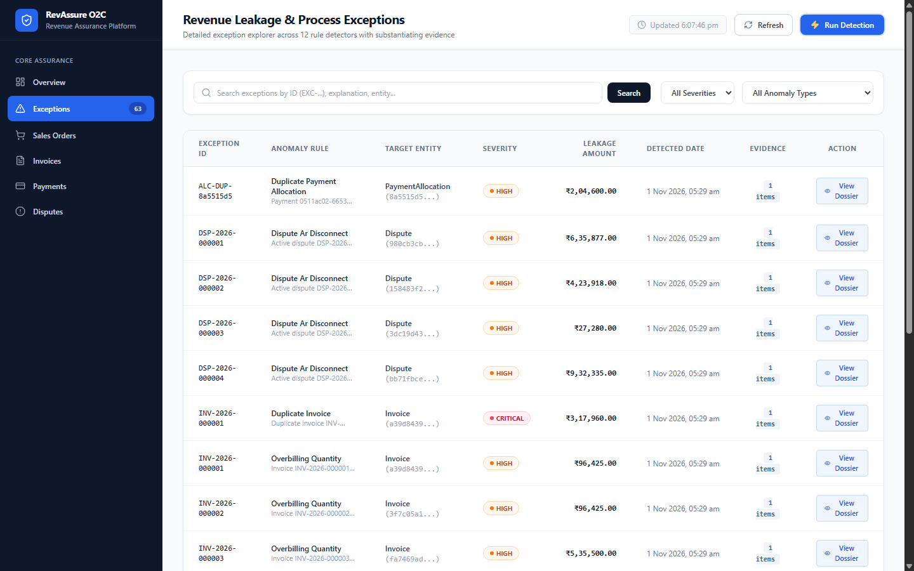
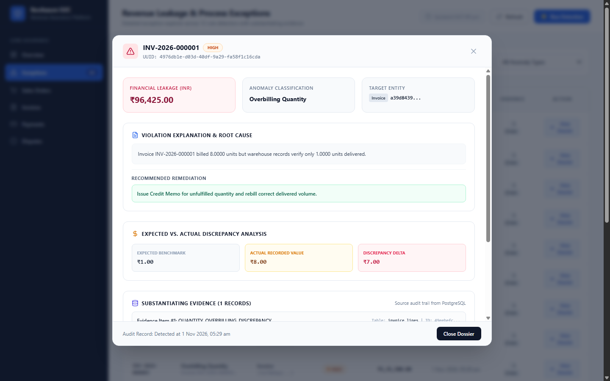
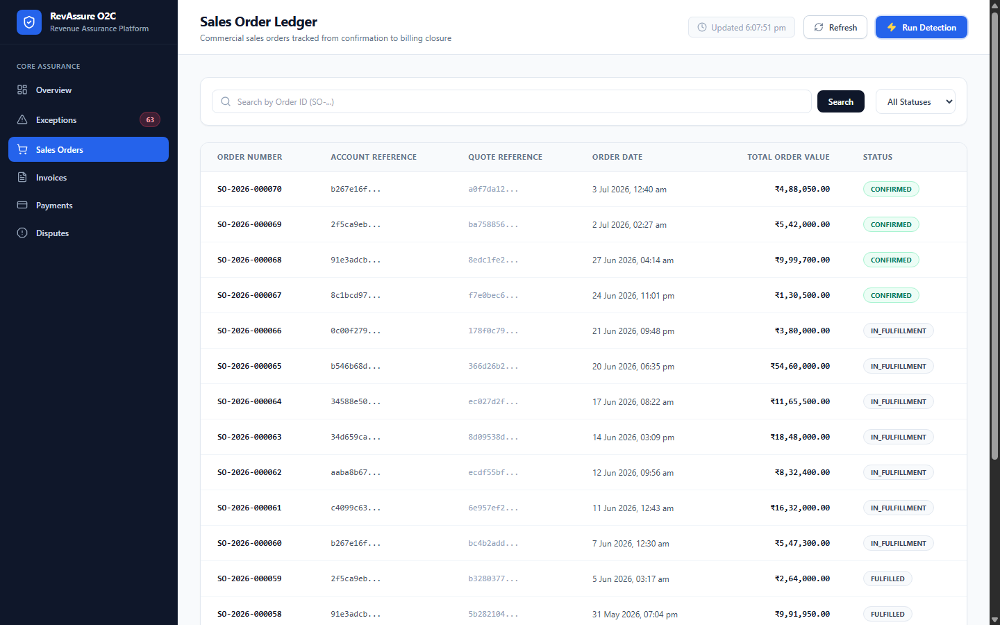
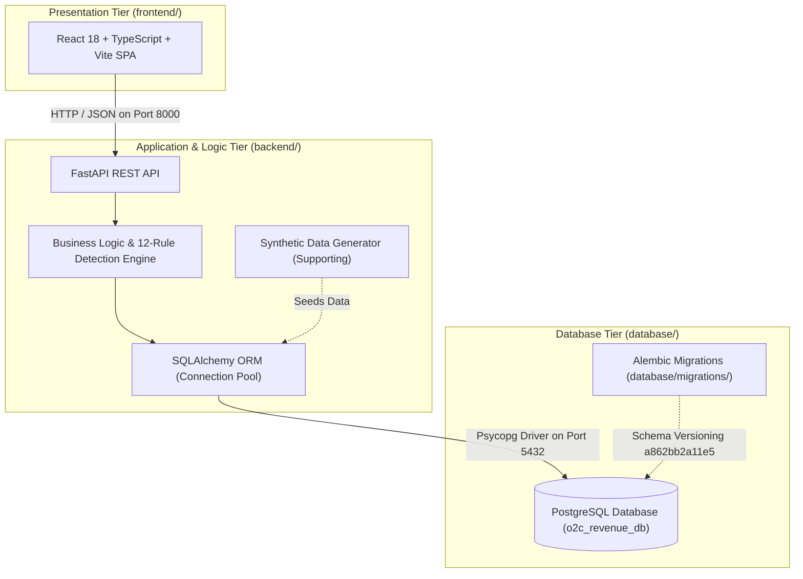

# Order-to-Cash (O2C) Revenue Assurance Platform

[](https://www.python.org/)
[](https://fastapi.tiangolo.com/)
[](https://react.dev/)
[](https://www.typescriptlang.org/)
[](https://www.postgresql.org/)
[](https://www.sqlalchemy.org/)
[](https://tailwindcss.com/)
[](https://vitejs.dev/)

An enterprise Order-to-Cash (O2C) Revenue Assurance and Leakage Detection Platform that unifies end-to-end commercial lifecycle transactions, identifies revenue leakage using 12 deterministic detection rules, synthesizes evidence-backed exception dossiers with expected vs. actual discrepancies, and quantifies financial impact in Indian Rupees (INR).

---

## Application Screenshots

Captured directly from the running application backed by live PostgreSQL queries:

### 1. Executive Revenue Assurance Overview Dashboard
Real-time operational KPIs, quantified revenue leakage in INR, risk severity distributions, active anomaly rule breakdown, and recent exceptions.


---

### 2. Exception Explorer
Interactive exception registry supporting search by business ID or description, severity filtering (`CRITICAL`, `HIGH`, `MEDIUM`, `LOW`), anomaly rule filtering, and one-click dossier inspection.



---

### 3. Exception Detail & Evidence Dossier
Inspection modal displaying root-cause explanations, recommended business remediation, side-by-side **Expected vs. Actual Discrepancy Analysis**, and structured JSON audit payloads linked to source database records.



---

### 4. Transactional Ledger (Sales Orders)
Unified transactional ledger providing operational visibility across customer accounts, order dates, commercial values, and fulfillment states.



---

## 1. Project Overview

Organizations process high volumes of commercial transactions across the Order-to-Cash (O2C) lifecycle:

$$\text{Account Master} \longrightarrow \text{Quote} \longrightarrow \text{Sales Order} \longrightarrow \text{Shipment} \longrightarrow \text{Invoice} \longrightarrow \text{Payment} \longrightarrow \text{Dispute / Reconciliation}$$

This platform reconciles cross-stage transactional data, detects 12 critical revenue leakage and process violation categories, synthesizes evidence dossiers with expected vs. actual discrepancies, and quantifies financial impact through an interactive React dashboard.

---

## 2. Actual Business Problem

In enterprise environments, the O2C workflow is typically fragmented across separate systems: CRM/CPQ (quotes), Order Management (sales orders), WMS (shipments), ERP (invoices), and Treasury/Banking (payments). Because these systems operate on different batch intervals and data schemas, **systemic revenue leakage** occurs silently:

- **Fulfillment vs. Billing Mismatches:** Invoicing the original order quantity rather than the actual delivered quantity (overbilling), or shipping goods without triggering an invoice (underbilling).
- **Duplicate Invoices:** Multiple active invoices generated for the same sales order and amount due to retries or batch errors.
- **Payment Allocation Errors:** The same remittance applied multiple times to an invoice, or total payments allocated in excess of the billable amount.
- **Short Payments & Overdue Invoices:** Unexplained customer deductions and past-due unpaid balances lingering without formal dispute holds.
- **Disconnected Records & Delayed Reconciliation:** Month-end manual spreadsheet reconciliations occur 30–45 days after transaction execution, by which time cash leakage has already materialized.

Organizations require a unified, automated revenue assurance solution that maintains relational integrity across lifecycle entities and detects financial leakage in real time.

---

## 3. Solution Approach

The platform resolves these failure modes through an automated, deterministic pipeline:

- **Unified Relational Modeling:** Models Accounts, Quotes, Orders, Shipments, Invoices, Payments, and Disputes in a strictly typed PostgreSQL database.
- **Lifecycle Event Auditing:** Records an immutable, append-only `status_events` audit trail for every entity state transition.
- **12 Deterministic Detection Rules:** Evaluates operational records against business invariants without relying on opaque black-box models.
- **Evidence-Backed Dossiers:** Calculates exact discrepancy deltas (Expected Benchmark vs. Recorded Actual) and attaches source record payloads.
- **Financial Leakage Quantification:** Computes the exact monetary exposure in INR ($\text{₹}$) for each exception.
- **Interactive Financial Dashboard:** Displays executive KPIs, risk severity stacks, anomaly rule breakdowns, and transactional ledgers with on-demand detection execution.
- **Isolated Evaluation Ground Truth:** Maintains a physically separated `ground_truth_anomalies` dataset strictly for offline benchmarking, never accessed by runtime detection engines or UI APIs.

---

## 4. System Architecture

The platform follows a three-tier architecture with separate top-level directories:
- `frontend/` — Presentation Layer (React 18 + TypeScript + Vite + Tailwind CSS)
- `backend/` — Application and Logic Layer (FastAPI + SQLAlchemy 2.x + Detection Engine)
- `database/` — Database and Schema Layer (PostgreSQL 18 + Alembic + Diagnostic Scripts)



---

## 5. Database Schema

The database maintains referential integrity across the full Order-to-Cash transaction graph:

| Entity / Table | Primary Key | Key Foreign Keys | Role in O2C Lifecycle |
| :--- | :--- | :--- | :--- |
| `accounts` | `account_id` | None | Customer master records, payment terms, and credit limits |
| `quotes` | `quote_id` | `account_id` | Commercial price quotes with validity dates |
| `quote_lines` | `line_id` | `quote_id` | Line-item pricing, quantities, and discounts |
| `sales_orders` | `order_id` | `account_id`, `quote_id` | Confirmed customer sales contracts and total order values |
| `order_lines` | `line_id` | `order_id` | Contracted products, unit prices, and line discounts |
| `shipments` | `shipment_id` | `order_id` | Warehouse dispatch notes and carrier tracking |
| `shipment_lines` | `line_id` | `shipment_id`, `order_line_id` | Bridge record: maps shipped inventory directly to order lines |
| `invoices` | `invoice_id` | `order_id`, `account_id` | Accounts receivable billing documents and outstanding balances |
| `invoice_lines` | `line_id` | `invoice_id`, `shipment_line_id`| Bridge record: maps billed quantities directly to shipment lines |
| `payments` | `payment_id` | `account_id` | Treasury bank remittances received and unallocated cash |
| `payment_allocations` | `allocation_id` | `payment_id`, `invoice_id` | Multi-invoice settlement bridge linking payments to invoices |
| `disputes` | `dispute_id` | `invoice_id` | Customer billing claims, disputed amounts, and status |
| `status_events` | `event_id` | `entity_id` | Append-only event history of state transitions with timestamps |
| `exception_records` | `exception_id` | Target `entity_id` | Flagged policy violations, leakage amount, and recommended actions |
| `exception_evidence` | `evidence_id` | `exception_id`, `source_id` | Expected vs actual values, discrepancy deltas, and audit JSON |
| `ground_truth_anomalies` | `anomaly_id` | Target `entity_id` | Isolated benchmark table populated strictly for offline evaluation |

---

## 6. Key Features

- **End-to-End Lifecycle Visibility:** Trace any transaction from quotation through shipment, billing, and cash application.
- **12 Rule-Based Anomaly Detectors:** Deterministic cross-entity audit logic covering fulfillment, billing, settlement, and workflow SLAs.
- **Revenue Leakage Quantification:** Exact financial loss calculation formatted in Indian Rupees ($\text{₹}$).
- **Evidence-Backed Dossiers:** Every exception includes root cause, recommended remediation, expected vs. actual variance, and source record references.
- **Interactive Executive Dashboard:** Real-time KPI summary cards, stacked severity distributions, and anomaly breakdown bars.
- **Exception Explorer:** Search by entity ID or description, filter by severity and rule type, and paginate through records.
- **Operational Data Tables:** Dedicated views for Sales Orders, Invoices, Payments, and Disputes.
- **On-Demand Detection Trigger:** Prominent "Run Detection" button with duplicate-submission protection that scans the database in sub-second time.

### The 12 Detection Rules

| Detector Rule | Business Meaning |
| :--- | :--- |
| `OVERBILLING_QUANTITY` | Invoiced quantity on an invoice line exceeds delivered quantity on shipment lines. |
| `OVERBILLING_AMOUNT` | Invoiced unit price or total line amount exceeds approved sales order pricing. |
| `UNDERBILLING` | Shipped goods remain unbilled or are invoiced below contractual sales order pricing. |
| `DUPLICATE_INVOICE` | Multiple active invoices generated for the identical sales order and billing amount. |
| `DUPLICATE_PAYMENT_ALLOCATION` | Same payment remittance applied multiple times to the same invoice. |
| `EXCESSIVE_PAYMENT_ALLOCATION` | Sum of payment allocations exceeds the total invoiced amount. |
| `PREMATURE_ORDER_CLOSURE` | Sales order marked `CLOSED` while linked invoices still have outstanding unpaid balances. |
| `INVALID_STATUS_TRANSITION` | Entity state transition skips required prerequisite operational states in event history. |
| `DISPUTE_AR_DISCONNECT` | AR collection or delinquency aging continues while an invoice is in active dispute status. |
| `SHORT_PAYMENT` | Unexplained partial customer payment without an associated dispute or credit adjustment. |
| `SLA_AGING_BREACH` | Fulfillment, invoicing, or settlement turnaround time exceeds established SLA cutoffs. |
| `OVERDUE_UNPAID_INVOICE` | Invoices past payment due date with zero payment and no active dispute claims. |

---

## 7. Technology Stack

| Layer | Technologies Used |
| :--- | :--- |
| **Frontend** | React 18.3, TypeScript 5.6, Vite 5.4, Tailwind CSS 3.4, Lucide React 0.468 |
| **Backend** | Python 3.12, FastAPI 0.110+, Pydantic v2, SQLAlchemy 2.0, Uvicorn, Pytest 8.4 |
| **Database** | PostgreSQL 18.6, Psycopg 3.2, Alembic 1.13+ |

---

## 8. Verified Results

Metrics verified on the active PostgreSQL database:

| Metric | Verified Value | Source / Notes |
| :--- | :---: | :--- |
| **Customer Accounts** | 10 | Master records |
| **Sales Orders** | 70 | Commercial orders |
| **Invoices** | 83 | AR billing invoices |
| **Payments** | 150 | Bank cash remittances |
| **Detected Exceptions** | **63** | Logged in `exception_records` across all 12 categories |
| **Total Revenue Leakage** | **₹31,377,824.50 (₹3.14 Cr)** | Exact sum of quantified leakage amounts |
| **Detection Duration** | **0.12 seconds** | Synchronous scan via `POST /api/detection/run` |
| **Automated Tests** | **21 / 21 Passed** | Pytest test suite in `backend/tests/` |

> **Note on Data Volumes:** The active database is currently populated with the deterministic `test` profile (70 orders, 83 invoices, 150 payments, 63 exceptions, ₹3.14 Cr leakage) for sub-second execution and rapid inspection. The generator also supports a benchmark `full` profile (7,000 orders, 8,000 invoices, ~276,000+ records, 385 anomalies) parameterized via `--profile full`.

---

## 9. Setup Instructions

Follow these PowerShell commands to run the platform locally on Windows.

### 1. Prerequisites
- Python 3.11+
- Node.js 18+
- PostgreSQL 15+ running on port `5432` with database `o2c_revenue_db`

### 2. Backend Setup
```powershell
cd C:\CandidateWorkspace\o2c-revenue-assurance-platform\backend

# Copy environment template and configure database password in .env
Copy-Item .env.example .env

# Initialize virtual environment and install dependencies
python -m venv .venv
.\.venv\Scripts\Activate.ps1
pip install -r requirements.txt

# Verify migrations (points to database/migrations/)
.\.venv\Scripts\alembic.exe current
# Expected: a862bb2a11e5 (head)

# Start FastAPI backend
.\.venv\Scripts\uvicorn.exe app.main:app --host 0.0.0.0 --port 8000 --reload
```
- Backend Swagger Docs: **http://localhost:8000/docs**
- Backend Health Check: **http://localhost:8000/health**

### 3. Frontend Setup
Open a separate PowerShell terminal:

```powershell
cd C:\CandidateWorkspace\o2c-revenue-assurance-platform\frontend

# Copy environment template
Copy-Item .env.example .env

# Install dependencies and start Vite dev server
npm install
npm run dev -- --host 0.0.0.0
```
- Frontend Application UI: **http://localhost:5173**
