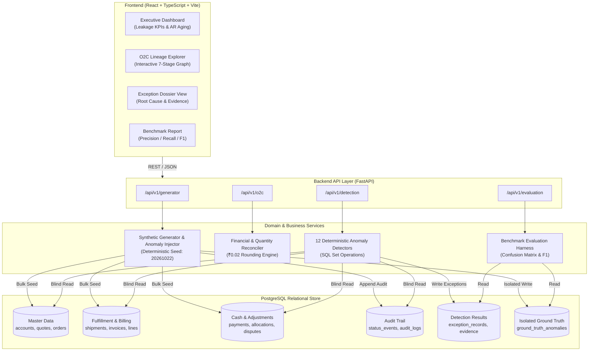
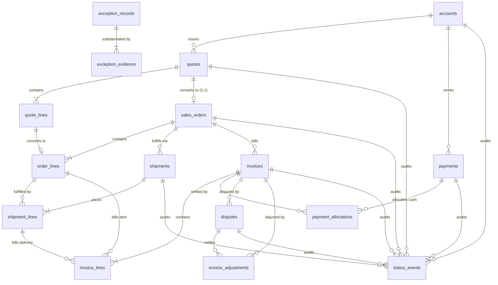
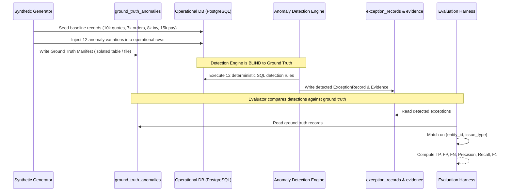

# ENTERPRISE SOLUTION ARCHITECTURE SPECIFICATION
## Order-to-Cash (O2C) Revenue Assurance and Revenue Leakage Detection Platform
**Document Version:** 1.0.0-ARCHITECTURE  
**Phase:** Solution Architecture & Technical Design (8-Hour Hackathon Delivery)  
**Status:** APPROVED FOR IMMEDIATE IMPLEMENTATION  
**Project Root:** `C:\CandidateWorkspace\o2c-revenue-assurance-platform`  
**Document Path:** `C:\CandidateWorkspace\o2c-revenue-assurance-platform\docs\SOLUTION_ARCHITECTURE.md`  
**Base Requirements Reference:** `docs/PROJECT_REQUIREMENTS.md`  

---

## 1. Architecture Overview and Rationale

The O2C Revenue Assurance Platform is designed as a **high-throughput, deterministic modular monolith** that tracks the complete financial and operational lifecycle:
$$\text{Account} \longrightarrow \text{Quote} \longrightarrow \text{Sales Order} \longrightarrow \text{Shipment} \longrightarrow \text{Invoice} \longrightarrow \text{Payment} \longrightarrow \text{Dispute}$$

### 1.1 Core Architectural Principles
1. **Modular Monolith over Microservices:** For an 8-hour delivery timeline, a modular monolith minimizes network overhead, eliminates distributed transaction complexities, allows single-database ACID guarantees, and runs smoothly on local developer environments.
2. **Deterministic & Explainable Detection:** Black-box ML models and non-deterministic LLMs are explicitly excluded. All 12 anomaly types are detected using set-based SQL queries and deterministic business rule evaluators.
3. **Decoupled Asynchronous Lifecycles:** Rather than collapsing status into a single column, the system preserves independent lifecycle state machines for Orders, Shipments, Invoices, Payments, and Disputes.
4. **Relational Integrity with Hard Foreign Keys:** Real PostgreSQL foreign keys and check constraints are enforced across all entities. Polymorphic loose references are strictly avoided.
5. **Strict Ground-Truth Isolation:** Synthetic generation produces a separate, isolated ground-truth manifest (`ground_truth_anomalies`), ensuring the detection engine operates blind to ground truth.

---

## 2. Technology Stack

| Layer | Technology | Purpose & Selection Justification |
| :--- | :--- | :--- |
| **Frontend Framework** | **React 18 + TypeScript + Vite** | Rapid build times, strict static typing, and reactive component rendering for real-time dashboards. |
| **Frontend Styling** | **Tailwind CSS + Lucide Icons** | Utility-first styling for fast, professional UI assembly without external component library bloat. |
| **Data Visualization** | **Recharts** | Declarative charting library for rendering A/R aging buckets, leakage heatmaps, and confusion matrices. |
| **Backend API** | **Python 3.11 + FastAPI** | High-performance asynchronous REST API framework with native OpenAPI documentation. |
| **Data Validation** | **Pydantic v2** | Ultra-fast Rust-backed schema validation and serialization for API requests and domain models. |
| **Database ORM** | **SQLAlchemy 2.0 (Mapped Column)** | Modern declarative ORM supporting typed queries, bulk inserts, and direct raw SQL execution. |
| **Schema Migrations** | **Alembic** | Version-controlled, reproducible database DDL migrations. |
| **Database Engine** | **PostgreSQL 15+** | ACID-compliant relational store with `UUIDv5`, `NUMERIC(15,2)`, indexing, and JSONB capabilities. |
| **Data Synthesis** | **NumPy + Pandas (Generator Engine)** | Vectorized, seeded generation of 10,000 quotes, 7,000 orders, 8,000 invoices, and 15,000 payments. |
| **Testing** | **Pytest + HTTPX** | Automated test runner for unit tests, integrity constraint tests, and detector benchmarking. |

---

## 3. System Architecture Diagram



---

## 4. Project Folder Structure

```
o2c-revenue-assurance-platform/
│
├── docs/
│   ├── PROJECT_REQUIREMENTS.md          # Primary Business Requirements
│   └── SOLUTION_ARCHITECTURE.md         # This Technical Architecture
│
├── backend/
│   ├── alembic/                         # Database Migration Scripts
│   │   ├── versions/
│   │   └── env.py
│   ├── app/
│   │   ├── api/                         # REST API Routers
│   │   │   ├── v1/
│   │   │   │   ├── generator.py         # Trigger data generation & export
│   │   │   │   ├── o2c.py               # Lineage & operational data lookup
│   │   │   │   ├── detection.py         # Run anomaly detection & exceptions
│   │   │   │   ├── evaluation.py        # Benchmark metrics & reporting
│   │   │   │   └── dashboard.py         # Aggregated KPIs & AR aging
│   │   │   └── router.py
│   │   ├── core/                        # Configuration & Database Session
│   │   │   ├── config.py                # Environment settings & tolerances
│   │   │   └── database.py              # SQLAlchemy engine & sessionmaker
│   │   ├── models/                      # SQLAlchemy 2.0 Declarative Models
│   │   │   ├── base.py
│   │   │   ├── master.py                # Account, Quote, QuoteLine, SalesOrder, OrderLine
│   │   │   ├── fulfillment.py           # Shipment, ShipmentLine
│   │   │   ├── billing.py               # Invoice, InvoiceLine, InvoiceAdjustment
│   │   │   ├── treasury.py              # Payment, PaymentAllocation, Dispute
│   │   │   ├── audit.py                 # StatusEvent, AuditLog, AppUser
│   │   │   ├── detection.py             # ExceptionRecord, ExceptionEvidence
│   │   │   └── ground_truth.py          # GroundTruthAnomaly (Isolated)
│   │   ├── schemas/                     # Pydantic v2 Serialization Schemas
│   │   │   ├── o2c.py
│   │   │   ├── detection.py
│   │   │   └── evaluation.py
│   │   ├── services/                    # Core Business Engines
│   │   │   ├── generator/               # Vectorized synthetic generator
│   │   │   │   ├── master_generator.py
│   │   │   │   ├── fulfillment_generator.py
│   │   │   │   ├── billing_generator.py
│   │   │   │   ├── treasury_generator.py
│   │   │   │   └── anomaly_injector.py
│   │   │   ├── detectors/               # 12 Deterministic Anomaly Detectors
│   │   │   │   ├── base.py
│   │   │   │   ├── overbilling.py       # ANOM-001, ANOM-002
│   │   │   │   ├── underbilling.py      # ANOM-003
│   │   │   │   ├── duplicate_invoice.py # ANOM-004
│   │   │   │   ├── payment_rules.py     # ANOM-005, ANOM-006, ANOM-010
│   │   │   │   ├── lifecycle_rules.py   # ANOM-007, ANOM-008
│   │   │   │   ├── dispute_rules.py     # ANOM-009
│   │   │   │   └── sla_aging_rules.py   # ANOM-011, ANOM-012
│   │   │   ├── reconciler.py            # Financial balance calculator
│   │   │   └── evaluator.py             # Precision, Recall, F1 Benchmarker
│   │   └── main.py                      # FastAPI application entrypoint
│   ├── tests/                           # Pytest Test Suite
│   │   ├── test_generator.py
│   │   ├── test_detectors.py
│   │   ├── test_reconciliation.py
│   │   └── test_api.py
│   ├── alembic.ini
│   ├── requirements.txt
│   └── pytest.ini
│
├── frontend/
│   ├── src/
│   │   ├── components/                  # Reusable UI Components
│   │   │   ├── Layout.tsx               # Sidebar & Topbar
│   │   │   ├── MetricCard.tsx           # KPI display card
│   │   │   ├── StatusBadge.tsx          # Color-coded state badge
│   │   │   ├── EvidenceModal.tsx        # Traceable exception evidence viewer
│   │   │   └── LineageGraph.tsx         # Node-link O2C lifecycle viewer
│   │   ├── pages/                       # Application Views
│   │   │   ├── DashboardPage.tsx        # High-level leakage & AR aging
│   │   │   ├── LineageExplorerPage.tsx  # End-to-end transaction journey
│   │   │   ├── ExceptionsPage.tsx       # Anomaly management & evidence drill-down
│   │   │   ├── EvaluationPage.tsx       # Precision, Recall, F1 Benchmark report
│   │   │   └── GeneratorControlPage.tsx # Seed control & dataset regeneration
│   │   ├── services/
│   │   │   └── api.ts                   # Axios / Fetch client
│   │   ├── types/                       # TypeScript Interface Definitions
│   │   │   └── index.ts
│   │   ├── App.tsx
│   │   ├── main.tsx
│   │   └── index.css
│   ├── package.json
│   ├── tsconfig.json
│   ├── tailwind.config.js
│   └── vite.config.ts
│
└── README.md
```

---

## 5. Database ER Diagram



---

## 6. Core Entities, Supporting Entities & Relational Design

To eliminate polymorphic loose references and satisfy strict database integrity, **all entity references use explicit foreign keys with check constraints**.

### 6.1 Master & Operational Entities
1. **`accounts`**: Master customer identity, billing address, credit limit (`NUMERIC(15,2)`), payment terms (`NET15`, `NET30`, `NET60`), currency (`INR`).
2. **`quotes`**: Commercial proposal. `account_id` FK. Business ID `QTE-2026-XXXXXX`. Status: `DRAFT`, `SUBMITTED`, `APPROVED`, `ACCEPTED`, `REJECTED`, `EXPIRED`, `CONVERTED`.
3. **`quote_lines`**: Itemized lines. `quote_id` FK. Line calculations: `gross_amount`, `discount_amount`, `line_net_amount`.
4. **`sales_orders`**: Legally binding contract. `quote_id` FK (Unique, 1:1 conversion), `account_id` FK. Business ID `SO-2026-XXXXXX`. Status: `DRAFT`, `CONFIRMED`, `IN_FULFILLMENT`, `PARTIALLY_FULFILLED`, `FULFILLED`, `CLOSED`, `CANCELLED`.
5. **`order_lines`**: Promised deliverables. `order_id` FK, `quote_line_id` FK. Tracks `ordered_quantity` (`NUMERIC(12,4)`), `unit_price`, and line status.
6. **`shipments`**: Physical dispatch records. `order_id` FK. Business ID `SHP-2026-XXXXXX`. Status: `PENDING`, `DISPATCHED`, `IN_TRANSIT`, `DELIVERED`, `LOST`, `RETURNED`, `CANCELLED`.
7. **`shipment_lines`**: Specific goods and quantities packed per shipment. `shipment_id` FK, `order_line_id` FK. Tracks `shipped_quantity`.
8. **`invoices`**: Financial payment demand. `order_id` FK, `account_id` FK. Business ID `INV-2026-XXXXXX`. Status: `DRAFT`, `ISSUED`, `PARTIALLY_PAID`, `PAID`, `VOIDED`, `WRITTEN_OFF`.
9. **`invoice_lines`**: Itemized billing entries. `invoice_id` FK, `order_line_id` FK, `shipment_line_id` FK (optional, linking to delivered shipment). Tracks `invoiced_quantity`, `unit_price`, `line_total_amount`.
10. **`payments`**: Cash or wire receipt. `account_id` FK. Business ID `PAY-2026-XXXXXX`. Status: `RECEIVED`, `PARTIALLY_ALLOCATED`, `ALLOCATED`, `BOUNCED`, `REFUNDED`.
11. **`payment_allocations`**: M:N bridge connecting `payments` to `invoices`. `payment_id` FK, `invoice_id` FK. Tracks `allocated_amount` (`NUMERIC(15,2)`).
12. **`disputes`**: Formal customer claims. `invoice_id` FK. Business ID `DSP-2026-XXXXXX`. Status: `LODGED`, `UNDER_INVESTIGATION`, `RESOLVED_ACCEPTED`, `RESOLVED_REJECTED`, `CANCELLED`.
13. **`invoice_adjustments`**: Credit/Debit memos. `invoice_id` FK, optional `dispute_id` FK. Types: `CREDIT_MEMO`, `DEBIT_MEMO`, `WRITE_OFF`.

### 6.2 Enforceable Relational Audit & Exception Entities

#### Concrete Foreign Keys for `status_events`
To enforce real foreign-key relationships rather than loose polymorphic strings:
```sql
CREATE TABLE status_events (
    event_id UUID PRIMARY KEY,
    entity_type VARCHAR(32) NOT NULL,
    quote_id UUID REFERENCES quotes(quote_id) ON DELETE CASCADE,
    order_id UUID REFERENCES sales_orders(order_id) ON DELETE CASCADE,
    shipment_id UUID REFERENCES shipments(shipment_id) ON DELETE CASCADE,
    invoice_id UUID REFERENCES invoices(invoice_id) ON DELETE CASCADE,
    payment_id UUID REFERENCES payments(payment_id) ON DELETE CASCADE,
    dispute_id UUID REFERENCES disputes(dispute_id) ON DELETE CASCADE,
    business_id VARCHAR(32) NOT NULL,
    previous_state VARCHAR(32),
    new_state VARCHAR(32) NOT NULL,
    event_timestamp TIMESTAMPTZ NOT NULL,
    actor_id UUID,
    reason TEXT,
    CONSTRAINT chk_status_event_exact_one_fk CHECK (
        (CASE WHEN quote_id IS NOT NULL THEN 1 ELSE 0 END +
         CASE WHEN order_id IS NOT NULL THEN 1 ELSE 0 END +
         CASE WHEN shipment_id IS NOT NULL THEN 1 ELSE 0 END +
         CASE WHEN invoice_id IS NOT NULL THEN 1 ELSE 0 END +
         CASE WHEN payment_id IS NOT NULL THEN 1 ELSE 0 END +
         CASE WHEN dispute_id IS NOT NULL THEN 1 ELSE 0 END) = 1
    )
);
```

#### Concrete Relationships for `exception_records` & `exception_evidence`
```sql
CREATE TABLE exception_records (
    exception_id UUID PRIMARY KEY,
    issue_type VARCHAR(64) NOT NULL,
    severity VARCHAR(16) NOT NULL,
    entity_type VARCHAR(32) NOT NULL,
    account_id UUID REFERENCES accounts(account_id),
    order_id UUID REFERENCES sales_orders(order_id),
    invoice_id UUID REFERENCES invoices(invoice_id),
    payment_id UUID REFERENCES payments(payment_id),
    dispute_id UUID REFERENCES disputes(dispute_id),
    business_id VARCHAR(32) NOT NULL,
    leakage_amount NUMERIC(15,2),
    detected_at TIMESTAMPTZ NOT NULL,
    explanation TEXT NOT NULL,
    recommended_action TEXT NOT NULL
);

CREATE TABLE exception_evidence (
    evidence_id UUID PRIMARY KEY,
    exception_id UUID NOT NULL REFERENCES exception_records(exception_id) ON DELETE CASCADE,
    evidence_type VARCHAR(64) NOT NULL,
    source_table VARCHAR(64) NOT NULL,
    source_id UUID NOT NULL,
    conflicting_table VARCHAR(64),
    conflicting_id UUID,
    expected_value NUMERIC(15,2),
    actual_value NUMERIC(15,2),
    discrepancy_delta NUMERIC(15,2),
    evidence_payload JSONB NOT NULL,
    created_at TIMESTAMPTZ NOT NULL
);
```

---

## 7. Key Database Constraints and Integrity Rules

| Rule ID | Database Constraint | Enforcement Mechanism |
| :--- | :--- | :--- |
| **INT-001** | Primary Key Uniqueness | Every table enforces `UUID` primary key with default `gen_random_uuid()` or deterministic UUIDv5. |
| **INT-002** | Business ID Uniqueness | Unique index on `business_id` across `quotes`, `sales_orders`, `shipments`, `invoices`, `payments`, `disputes`. |
| **INT-003** | Monotonic Quantities | `CHECK (quantity > 0)` on `quote_lines`, `order_lines`, `shipment_lines`, `invoice_lines`. |
| **INT-004** | Cumulative Shipment Bound | In baseline data: $\sum \text{shipped\_qty} \le \text{order\_line.ordered\_quantity}$. |
| **INT-005** | Cumulative Invoiced Bound | In baseline data: $\sum \text{invoiced\_qty} \le \sum \text{shipped\_qty}$. (Violations flagged as `ANOM-001`). |
| **INT-006** | Payment Allocation Limit | $\sum \text{allocated\_amount} \le \text{payment.amount\_received} + ₹0.02$. (Violations flagged as `ANOM-006`). |
| **INT-007** | Invoice Settlement Limit | $\sum \text{allocated\_amount} \le \text{invoice.total\_invoiced\_amount} + ₹0.02$. |
| **INT-008** | Append-Only Audit Trail | `status_events` and `audit_logs` disallow `UPDATE` and `DELETE` via database triggers. |
| **INT-009** | Decimal Precision | All currency columns defined as `NUMERIC(15,2)`. All physical quantities defined as `NUMERIC(12,4)`. |

---

## 8. API Endpoint Design Grouped by Module

All endpoints are prefixed with `/api/v1` and return standardized JSON responses:

### 8.1 Module 1: Synthetic Generator & Seed Management (`/api/v1/generator`)
- `POST /generator/generate`: Trigger deterministic data generation.
  - **Payload:** `{"seed": 20261022, "scale_factor": 1.0, "inject_anomalies": true}`
  - **Response:** Record counts, execution duration, SHA-256 checksums.
- `GET /generator/status`: Get current generation state and table row counts.
- `GET /generator/manifest`: Download JSON manifest of generated datasets and checksums.

### 8.2 Module 2: O2C Pipeline Exploration & Lineage (`/api/v1/o2c`)
- `GET /o2c/lineage/{entity_type}/{business_id}`: Reconstruct the complete 7-stage lineage graph for any transaction ID (e.g. `INV-2026-000104`).
- `GET /o2c/orders`: Paginated list of sales orders with fulfillment and billing status.
- `GET /o2c/invoices`: Paginated list of invoices with outstanding balances and dispute flags.
- `GET /o2c/payments`: Paginated list of payments with allocation breakdowns.
- `GET /o2c/disputes`: List of active and resolved disputes.

### 8.3 Module 3: Anomaly Detection Engine (`/api/v1/detection`)
- `POST /detection/run`: Execute the 12 deterministic anomaly detectors against the operational database.
  - **Payload:** `{"rule_filter": ["ALL"]}`
  - **Response:** Total exceptions found, total leakage amount, breakdown by `issue_type`.
- `GET /detection/exceptions`: Paginated list of detected `exception_records` with filtering by `issue_type`, `severity`, and date.
- `GET /detection/exceptions/{exception_id}`: Detailed exception dossier including associated `exception_evidence` rows.
- `GET /detection/summary`: Aggregate metrics grouped by issue type, total financial leakage (in ₹), and severity.

### 8.4 Module 4: Ground-Truth Benchmark & Evaluation (`/api/v1/evaluation`)
- `POST /evaluation/benchmark`: Run the evaluation harness comparing detected exceptions with `ground_truth_anomalies`.
- `GET /evaluation/metrics`: Return global and per-anomaly metrics: TP, FP, FN, Precision, Recall, and F1 Score.
- `GET /evaluation/confusion-matrix`: Return confusion matrix dataset formatted for Recharts heatmap display.
- `GET /evaluation/report`: Export full evaluation benchmark as markdown or JSON.

### 8.5 Module 5: Executive Analytics & Dashboards (`/api/v1/dashboard`)
- `GET /dashboard/kpis`: Return total revenue, total invoiced, total cash collected, active disputes, and detected leakage.
- `GET /dashboard/ar-aging`: Return Accounts Receivable aging buckets (`CURRENT`, `1-30`, `31-60`, `61-90`, `90+` days) with disputed balances isolated.
- `GET /dashboard/leakage-breakdown`: Return revenue leakage distribution across overbilling, underbilling, duplicate invoices, and misallocations.

---

## 9. Synthetic Data Generation and Anomaly Injection Pipeline

### 9.1 Reproducible Deterministic Sizing
The generator guarantees **100% bitwise reproducibility** using a master seed (`20261022`).
- **UUIDv5 Identifiers:** All primary keys derive deterministically: `uuid5(NAMESPACE_DNS, f"{entity_type}:{business_id}")`.
- **Fixed Simulated Timeframe:** All events simulate between `2026-01-01T00:00:00Z` and `2026-10-31T23:59:59Z`.
- **Target Volume Registry:**
  - 10,000 Quotes (`QTE-2026-000001` to `QTE-2026-010000`)
  - 7,000 Sales Orders (`SO-2026-000001` to `SO-2026-007000`)
  - 7,500 Shipments (`SHP-2026-000001` to `SHP-2026-007500`)
  - 8,000 Invoices (`INV-2026-000001` to `INV-2026-008000`)
  - **15,000 Discrete Payments** (`PAY-2026-000001` to `PAY-2026-015000`)
  - ~20,000 Payment Allocations (distinct bridge rows)
  - ~500 Disputes (`DSP-2026-000001` to `DSP-2026-000500`)
  - ~85,000 Status Events (append-only lifecycle transitions)

### 9.2 Generation Order & Pipeline Stages
1. **Stage 1 (Master Data):** Generate Accounts with credit limits and payment terms.
2. **Stage 2 (Quotes & Lines):** Generate quotes with itemized products, list prices, and negotiated discounts.
3. **Stage 3 (Sales Orders):** Convert 70% of quotes (`ACCEPTED`) into Sales Orders with 1:1 line mappings.
4. **Stage 4 (Fulfillments & Lines):** Generate single and partial shipments against confirmed orders.
5. **Stage 5 (Billing & Lines):** Generate invoices mapping to delivered shipment lines. Support consolidated invoices spanning multiple partial shipments.
6. **Stage 6 (Cash & Allocations):** Generate 15,000 discrete payments. Allocate payments across open invoices.
7. **Stage 7 (Disputes & Adjustments):** Generate disputes on 5-6% of invoices; issue credit memos for resolved disputes.
8. **Stage 8 (Anomaly Injection):** Inject controlled anomalies across valid baseline data, recording expected labels in `ground_truth_anomalies`.
9. **Stage 9 (Checksum Manifest):** Export table manifests and compute SHA-256 hashes.

---

## 10. Detection Engine Architecture for All 12 Anomaly Types

Every detector is implemented as an explainable, deterministic evaluator executing directly against operational database records:

| Anomaly ID | Issue Type Code | Detection SQL / Set Logic | Quantified Leakage Calculation |
| :--- | :--- | :--- | :--- |
| **ANOM-001** | `OVERBILLING_QUANTITY` | `invoice_lines.invoiced_quantity > COALESCE(delivered_qty, 0)` | `(invoiced_qty - delivered_qty) * unit_price` |
| **ANOM-002** | `OVERBILLING_AMOUNT` | `invoice_lines.unit_price > order_lines.unit_price + 0.02` | `(inv_unit_price - order_unit_price) * invoiced_qty` |
| **ANOM-003** | `UNDERBILLING` | `invoice_lines.unit_price < order_lines.unit_price - 0.02` OR delivered shipment line unbilled after 5 days | `(order_unit_price - inv_unit_price) * invoiced_qty` |
| **ANOM-004** | `DUPLICATE_INVOICE` | Group by `(order_id, product_sku, invoiced_quantity, line_total_amount)` with `COUNT(DISTINCT invoice_id) > 1` | `SUM(duplicate_invoice.total_invoiced_amount)` |
| **ANOM-005** | `DUPLICATE_PAYMENT_ALLOCATION` | Group by `(payment_id, invoice_id, allocated_amount)` with `COUNT(*) > 1` | `(COUNT(*) - 1) * allocated_amount` |
| **ANOM-006** | `EXCESSIVE_PAYMENT_ALLOCATION` | `SUM(payment_allocations.allocated_amount) > payments.amount_received + 0.02` | `SUM(allocated_amount) - amount_received` |
| **ANOM-007** | `PREMATURE_ORDER_CLOSURE` | `sales_orders.status = 'CLOSED'` AND `EXISTS (SELECT 1 FROM invoices WHERE order_id = sales_orders.order_id AND (status != 'PAID' OR outstanding_balance > 0.02))` | `SUM(unpaid_invoices.outstanding_balance)` |
| **ANOM-008** | `INVALID_STATUS_TRANSITION` | Join consecutive `status_events` for same entity; verify transition against Allowed State Transition Matrix | Operational Audit Flag (Leakage = ₹0.00) |
| **ANOM-009** | `DISPUTE_AR_DISCONNECT` | Invoice has active dispute (`LODGED`/`UNDER_INVESTIGATION`), but `invoices.is_disputed_flag = FALSE` in receivables view | `disputes.disputed_amount` |
| **ANOM-010** | `SHORT_PAYMENT` | `invoices.paid_amount > 0` AND `invoices.outstanding_balance > 0.02` AND `NOW() > invoices.due_date` AND zero active disputes AND zero credit adjustments | `invoices.outstanding_balance` |
| **ANOM-011** | `SLA_AGING_BREACH` | Timestamp delta breaches threshold: Order $\to$ Dispatch $> 3$ days; Delivery $\to$ Invoice $> 2$ days; Dispute $> 14$ days | Operational Risk Flag (Leakage = ₹0.00) |
| **ANOM-012** | `OVERDUE_UNPAID_INVOICE` | `invoices.paid_amount = 0` AND `NOW() > invoices.due_date` AND zero active disputes | `invoices.total_invoiced_amount` |

---

## 11. Ground-Truth Isolation and Evaluation Architecture



### 11.1 Ground-Truth Isolation Guarantees
- The ground-truth manifest is stored in a separate table (`ground_truth_anomalies`) and exported to `ground_truth.json`.
- The detector service module imports **only** operational models (`models.master`, `models.fulfillment`, `models.billing`, `models.treasury`, `models.audit`).
- The evaluation engine is the **only component** with permission to read both `exception_records` and `ground_truth_anomalies`.

---

## 12. Frontend Pages and Component Structure

```mermaid
graph TD
    App[App Container & Navigation]
    App --> DashPage[1. Executive Dashboard Page]
    App --> LineagePage[2. O2C Lineage Explorer Page]
    App --> ExcPage[3. Exception Dossier Page]
    App --> EvalPage[4. Evaluation Benchmark Page]
    App --> GenPage[5. Generator Control Page]

    DashPage --> MetricCards[KPI Metric Cards: Leakage, Invoiced, AR]
    DashPage --> LeakageChart[Revenue Leakage by Anomaly Type - Recharts Bar]
    DashPage --> ARAgingChart[AR Aging Buckets with Disputed Balance - Recharts Stacked]

    LineagePage --> SearchBar[Entity Lookup by Business ID]
    LineagePage --> TimelineView[7-Stage Journey Timeline]
    LineagePage --> StateCards[State & Balance Inspector]

    ExcPage --> FilterBar[Filter by Issue Type, Severity, Date]
    ExcPage --> ExcTable[Exceptions List with Financial Delta]
    ExcPage --> EvidenceModal[Explainable Evidence Inspector & Source IDs]

    EvalPage --> ConfusionMatrix[Confusion Matrix Heatmap]
    EvalPage --> MetricGrid[Precision, Recall, F1 Cards]
    EvalPage --> CategoryTable[Per-Anomaly Score Breakdown Table]

    GenPage --> SeedInput[Random Seed & Scale Controls]
    GenPage --> RunButton[Execute Deterministic Generation]
    GenPage --> ChecksumCard[SHA-256 Checksum & Row Count Manifest]
```



---

## 13. Security, Validation and Error Handling

1. **Input Validation:** All API inputs validate through strict Pydantic v2 schemas with regex patterns enforcing business ID structures (`^INV-\d{4}-\d{6}$`).
2. **Database Transactions:** Multi-record operations (e.g. order conversion, cash allocation) execute within explicit SQLAlchemy transaction blocks with automatic rollback on failure:
   ```python
   async with async_session() as session:
       async with session.begin():
           # Atomic operations
   ```
3. **HTTP Error Envelope:** All error responses follow RFC 7807 Problem Details:
   ```json
   {
     "error_code": "RESOURCE_NOT_FOUND",
     "message": "Invoice INV-2026-000104 not found",
     "timestamp": "2026-11-15T15:45:00Z"
   }
   ```
4. **CORS & Environment:** Configured via `pydantic-settings` with default local development origins (`http://localhost:5173`).

---

## 14. Testing Strategy

1. **Unit Tests (`tests/test_reconciliation.py`):**
   - Verify line-to-header math: `gross - discount + tax = line_net`.
   - Verify ₹0.02 rounding tolerance.
   - Verify short-payment calculation excluding credit adjustments.
2. **Detector Tests (`tests/test_detectors.py`):**
   - Test each of the 12 anomaly detectors against isolated fixtures with known anomalies and clean records.
   - Verify zero false positives on clean baseline data.
3. **Generator Reproducibility Tests (`tests/test_generator.py`):**
   - Run generator twice with seed `20261022`. Verify exact matching SHA-256 checksums on exported tables.
4. **End-to-End Benchmark Test (`tests/test_evaluation.py`):**
   - Execute full pipeline: Generate $\to$ Detect $\to$ Evaluate.
   - Assert $\text{Precision} \ge 0.95$, $\text{Recall} \ge 0.95$, and $\text{F1 Score} \ge 0.95$.

---

## 15. Implementation Sequence Prioritized for an 8-Hour Hackathon

| Hour | Focus Area | Deliverables & Milestones | Verification Gate |
| :---: | :--- | :--- | :--- |
| **0.0 - 0.5** | **Scaffolding** | Setup Python FastAPI backend and Vite React frontend structures. | Backend runs on `:8000`, frontend runs on `:5173`. |
| **0.5 - 1.5** | **Database & Models** | PostgreSQL setup, SQLAlchemy models, and Alembic migration. | All 18 tables created with real foreign keys. |
| **1.5 - 3.0** | **Synthetic Generator** | Vectorized generator with seed `20261022` (10k quotes, 7k orders, 8k invoices, 15k payments). | Reproducible SHA-256 checksums verified. |
| **3.0 - 4.0** | **Anomaly Injection** | Inject all 12 anomaly types; output separate `ground_truth_anomalies`. | Ground-truth manifest isolated on disk. |
| **4.0 - 5.5** | **Detection Engine** | Implement 12 deterministic SQL anomaly detection engines. | Detectors return valid `ExceptionRecord` and `Evidence`. |
| **5.5 - 6.0** | **Evaluation Harness** | Build confusion matrix and precision/recall/F1 scoring engine. | Automated test achieves F1 $\ge 0.95$. |
| **6.0 - 7.0** | **REST APIs** | Build FastAPI endpoints for lineage, exceptions, and dashboard metrics. | Swagger UI renders and responds with live data. |
| **7.0 - 7.5** | **React Frontend** | Dashboard, Lineage Explorer, Exception Dossier, and Benchmark views. | UI displays interactive charts and evidence modals. |
| **7.5 - 8.0** | **End-to-End Demo** | Integration test run, README documentation, demo walkthrough. | Evaluator can inspect live PostgreSQL data and UI. |

---

*End of Solution Architecture Specification.*  
*Ready for immediate project scaffolding and implementation.*
